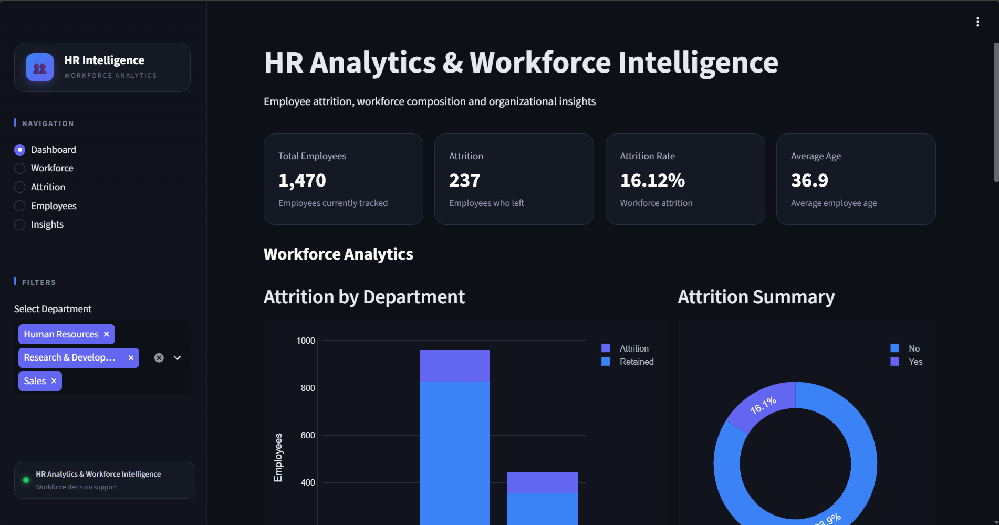
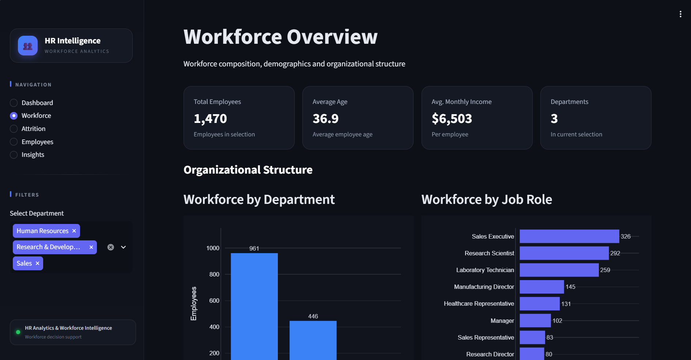
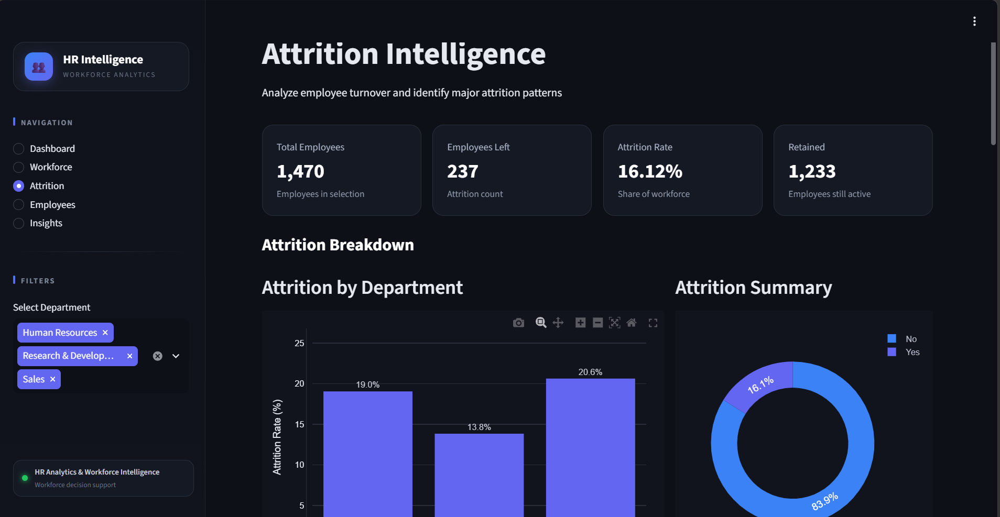
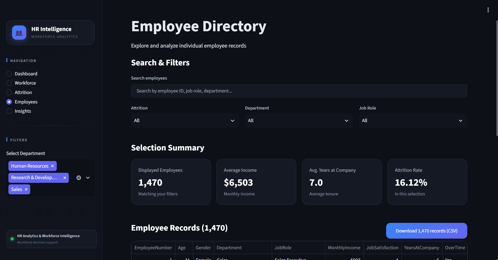
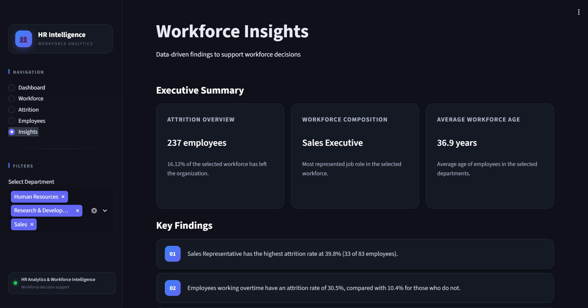

# 👥 HR Analytics & Workforce Intelligence

> An interactive HR analytics application for exploring & analyzing workforce composition, employee attrition, tenure and promotion patterns, and data-driven HR insights using Python, SQL and Streamlit. Filter by department and every KPI, chart, record and insight updates automatically.

[🚀 Live Demo](https://hr-analytics-workforce-intelligence-uhhva7wamfe5kcnfpcp7wa.streamlit.app/) · [📊 GitHub Repository](https://github.com/ParasKamble02/HR-Analytics-Workforce-Intelligence)


## Table of Contents

- [Overview](#overview)
- [Screenshots](#screenshots)
- [Features](#features)
- [How the Metrics Work](#how-the-metrics-work)
- [Tech Stack](#tech-stack)
- [Project Structure](#project-structure)
- [Getting Started](#getting-started)
- [Dataset](#dataset)
- [Configuration](#configuration)
- [Data Preparation](#data-preparation)
- [SQL Analysis](#sql-analysis)
- [Project Scope](#project-scope)
- [Deployment](#deployment)
- [Roadmap](#roadmap)
- [Author](#author)
- [License](#license)

---

## Overview

**HR Analytics & Workforce Intelligence** is an interactive data analytics web application built using Python, Pandas, Plotly, SQL/MySQL, and Streamlit. 
The application transforms employee-level HR data into an interactive analytics platform where users can explore workforce demographics, analyze employee attrition, investigate workforce patterns, filter employee records, and generate data-driven HR insights. The project focuses on descriptive and diagnostic HR analytics.

**Questions the app helps answer**

- How large is the workforce, and how many employees have left?
- Which departments and job roles have the highest attrition?
- How do overtime, job satisfaction, tenure and promotion gaps relate to attrition?
- Do employees who leave earn less than those who stay?
- Which employee records match specific HR criteria?
- Which workforce segments deserve further investigation?

---

## Screenshots

| Dashboard | Workforce |
|---|---|
|  |  |

| Attrition | Employees |
|---|---|
|  |  |

| Insights |
|---|
|  |

---

## 🎯 Project Objectives

- Analyze overall workforce composition
- Understand employee attrition and retention patterns
- Identify departments and job roles with higher attrition
- Analyze employee demographics
- Examine income and tenure relationships
- Analyze tenure and promotion patterns
- Investigate overtime and job satisfaction patterns
- Provide interactive employee-level exploration
- Generate dynamic workforce insights
- Support HR decision-making through data analytics
- Allow filtered employee data to be exported as CSV

---

## 📊 Analytics Workflow

The Project follows an end-to-end HR analytics workflow:

```text
HR Employee Dataset
        ↓
Data Loading
        ↓
Data Cleaning & Validation
        ↓
Exploratory Data Analysis
        ↓
SQL Analysis
        ↓
Statistical/KPI Analysis
        ↓
Workforce Analysis
        ↓
Attrition Analysis
        ↓
Employee Exploration
        ↓
Interactive Filtering
        ↓
Dynamic Insights
        ↓
Recommended Actions
        ↓
CSV Export
```
---

## Features

### 📊 Dashboard

A high-level view of workforce health.

- **Headline KPIs:** total employees, employees who left, attrition rate, average age
- **Workforce Health KPIs:** average tenure, average monthly income, overtime percentage, average job satisfaction
- **Charts:** attrition by department, attrition summary donut, attrition by job role
- **Key Workforce Insights:** attrition overview, most represented role, average workforce age

### 👥 Workforce

Workforce composition and demographics.

- Headcount by department and by job role
- Age distribution, gender composition and education field
- **Compensation & Tenure:** average income of retained employees and leavers, the leavers' pay gap, and a plain-language pay-versus-tenure indicator
- **Income vs. Tenure** scatter plot, with retained employees and leavers shown in different colors

### 📉 Attrition

Why and where employees leave.

- Attrition rate by department and by job role
- Attrition vs. overtime and vs. job satisfaction
- **Tenure & Promotion:** average tenure, years since last promotion, share of employees with stalled promotion, and attrition among them
- Attrition by tenure band and by years since last promotion, with group sizes (`n`) shown under each bar

### 🔎 Employees

Employee-level exploration.

- Free-text search across the records
- Quick filters for attrition, department and job role
- Selection summary KPIs: displayed employees, average income, average tenure, attrition rate
- Full records table
- **CSV export** of exactly the records currently shown

```text
Filter → Explore → Identify → Export
```

### 💡 Insights

Findings and recommendations calculated from the current selection.

**Key Findings (6)**

1. Job role with the highest attrition rate
2. Overtime attrition compared with non-overtime
3. Job satisfaction and turnover
4. Most represented job role
5. Promotion stagnation and attrition
6. Income of leavers vs. retained employees

**Recommended Actions (6)** respond to those findings, for example *Target High-Attrition Roles*, *Reduce Overtime Pressure*, *Improve Job Satisfaction*, *Plan Around Key Roles*, *Review Promotion Paths* and *Review Compensation*.

The wording adapts to the data. If overtime is not linked to higher attrition in the selection, the page says so instead of recommending action. When a group is too small to compare, the page says there is not enough data.

### 🎛️ Interactive Filtering

The sidebar department filter (Research & Development, Human Resources, Sales) drives every page. Changing it updates KPIs, charts, attrition calculations, employee records, insights and recommendations without touching the underlying dataset.

### 🎨 User Interface

- Dark analytics theme with a blue/indigo palette
- Card-based KPI and insight layout
- Fixed-width sidebar with navigation, filter and a pinned footer card
- Shared chart styling across all pages
- Consistent spacing and typography

---

## How the Metrics Work

| Metric | Definition |
|---|---|
| **Attrition rate** | Employees with `Attrition = Yes` ÷ employees in the current selection × 100 |
| **Promotion stalled** | 5 or more years since the last promotion (`STALLED_YEARS` in `utils/metrics.py`) |
| **Low job satisfaction** | Ratings of 1–2, compared with ratings of 3–4 |
| **Leavers' pay gap** | (Average income of leavers − average income of retained) ÷ average income of retained |
| **Pay vs. tenure** | Correlation between monthly income and years at company, shown as *None / Weak / Moderate / Strong* with the direction |
| **Small-group protection** | Comparisons ignore groups with fewer than 10 employees (`MIN_GROUP`), so a tiny group cannot produce a misleading percentage |

**Full dataset snapshot (all departments selected)**

| Total employees | Employees left | Retained | Attrition rate |
|---|---|---|---|
| 1,470 | 237 | 1,233 | 16.12% |


---

## Tech Stack

| Technology | Purpose |
|---|---|
| **Python** | Application logic |
| **Streamlit** | Web application and multi-page layout |
| **pandas** | Data cleaning, transformation and analysis |
| **NumPy** | Numerical operations |
| **Plotly** | Interactive charts |
| **HTML / CSS** | UI customization (cards, sidebar, theme) |
| **SQL / MySQL** | Exploratory HR data analysis (see [SQL Analysis](#sql-analysis)) |
| **Git & GitHub** | Version control and hosting |

---

## Project Structure

```text
HR-Analytics-Workforce-Intelligence/
├── README.md
├── .gitignore
├── screenshots/
├── data/
│   └── HR-Employee-Attrition.csv
├── excel/                        
│   └── HR-Analytics.xlsx         # Excel analysis files
├── sql/
│   └── hr_analytics.sql          # MySQL analysis queries
├── python/
│   └── hr_analysis.ipynb         # Jupyter notebook: cleaning, EDA, statistics
├── powerbi/
│   ├── screenshots
│   └── HR-Employee-Attrition.pbix  # Power BI dashboard
└── Streamlit/
    ├── .streamlit/
    │   └── config.toml          # Theme and client settings
    ├── assets/
    ├── components/
    │   ├── cards.py             # KPI and insight cards
    │   ├── charts.py            # Shared chart style and colors
    │   ├── hr_charts.py         # Tenure, promotion and income charts
    │   ├── sidebar.py           # Brand, navigation, department filter
    │   └── styles.py            # Global CSS
    ├── pages/
    │   ├── dashboard.py
    │   ├── workforce.py
    │   ├── attrition.py
    │   ├── employees.py
    │   └── insights.py
    ├── utils/
    │   ├── calculations.py
    │   ├── data_loader.py
    │   ├── helpers.py
    │   └── metrics.py           # HR metric calculations
    ├── app.py                   # Entry point and page routing
    └── requirements.txt
```

---

## Getting Started

### 1. Clone the repository

```bash
git clone https://github.com/ParasKamble02/HR-Analytics-Workforce-Intelligence.git
cd HR-Analytics-Workforce-Intelligence
```

### 2. Create a virtual environment

```bash
python -m venv venv
```

Windows:

```bash
venv\Scripts\activate
```

macOS / Linux:

```bash
source venv/bin/activate
```

### 3. Install dependencies

```bash
cd Streamlit
pip install -r requirements.txt
```

`requirements.txt` contains:

```text
streamlit
numpy
pandas
plotly
```

### 4. Add the dataset

Place the HR dataset as a CSV file (for example `HR-Employee-Attrition.csv`) in the `data/` folder. The application loads the first `.csv` file it finds there.

### 5. Run the app

From the `Streamlit` folder:

```bash
python -m streamlit run app.py
```

Open the local URL shown in the terminal, usually `http://localhost:8501`.

---

## Dataset

The project uses an employee attrition dataset in the style of the **IBM HR Analytics Employee Attrition** dataset (1,470 employee records).

| Area | Columns used |
|---|---|
| Demographics | `Age`, `Gender`, `EducationField` |
| Organization | `Department`, `JobRole` |
| Compensation | `MonthlyIncome` |
| Tenure & career | `YearsAtCompany`, `YearsSinceLastPromotion` |
| Engagement | `JobSatisfaction`, `OverTime` |
| Outcome | `Attrition` (`Yes` / `No`) |
| Identification | `EmployeeNumber` |

If a column is missing, the related KPI shows `N/A` and its chart is skipped instead of crashing the app.

---

## Configuration

Theme and client settings live in `Streamlit/.streamlit/config.toml`:

```toml
[theme]
base = "dark"
primaryColor = "#6366F1"
backgroundColor = "#0d1017"
secondaryBackgroundColor = "#11141d"
textColor = "#e6e9f0"

[client]
showSidebarNavigation = false
toolbarMode = "viewer"
```

---

## Data Preparation

Before any analysis, the app:

- Trims whitespace from column names and text values
- Normalizes `Attrition` values to `Yes` / `No`
- Normalizes department and job-role text
- Handles missing analytical columns gracefully
- Handles empty selections with a clear message instead of an error

---

## SQL Analysis

SQL / MySQL was used for exploratory analysis of the same HR dataset, including employee counts, attrition rates, department and job-role breakdowns and overtime analysis. The Streamlit application itself reads the dataset with pandas and presents the results through the interactive interface. 
**SQL Analysis File:** [`hr_analytics.sql`](sql/hr_analytics.sql)

---

## Python Analysis

Python was used in Jupyter Notebook for data cleaning, exploratory data analysis (EDA), statistical analysis, and visualization of the HR dataset. The analysis was used to identify workforce patterns and factors associated with employee attrition.
**Python Analysis Notebook:** [`hr_analysis.ipynb`](python/hr_analysis.ipynb)

---

## Power BI Dashboard

Power BI was used to build an interactive HR Analytics dashboard for workforce and attrition analysis. The dashboard provides KPI-driven insights into employee demographics, departments, job roles, compensation, tenure, job satisfaction, overtime, and attrition patterns.
**Power BI Dashboard:** [`HR-Employee-Attrition.pbix`](powerbi/HR-Employee-Attrition.pbix)

---

## Project Scope

**Included**

- Descriptive and diagnostic HR analytics
- Workforce and attrition analysis
- Employee-level search, filtering and CSV export
- Interactive department filtering
- Dynamic KPIs, insights and recommended actions

**Future Enhancement**

- Machine-learning attrition prediction
- Predictive attrition risk scoring
- Advanced employee segmentation
- Additional filters for job role, age, and tenure
- Automated HR reports
- PDF report generation
- Advanced workforce trend analysis
- Scheduled report generation
- Authentication

---

## Deployment

The app can be deployed on [Streamlit Community Cloud](https://streamlit.io/cloud).

1. Push the project to GitHub.
2. Make sure `requirements.txt` is committed.
3. Include the `data/` folder if you want the deployed app to load the dataset.
4. Set the main file path to `Streamlit/app.py`.
5. Deploy.

---

## Roadmap

- [x] Data preparation and validation
- [x] Workforce analytics
- [x] Attrition analytics, including tenure and promotion
- [x] Employee explorer with CSV export
- [x] Dynamic insights and recommended actions
- [x] Additional filters (job role, age band, tenure band)
- [x] PDF report export
- [x] UI polish and shared theme
- [x] GitHub repository setup
- [X] Deployment

---

## Author

**Paras Kamble**
B.Tech — Artificial Intelligence & Data Science
Loknete Shamrao Peje Government College of Engineering, Ratnagiri, Maharashtra

Areas of interest: Data Analytics, Data Science, Python, SQL, Data Visualization, Machine Learning

---

## License

This project is intended for educational, portfolio and demonstration purposes.
